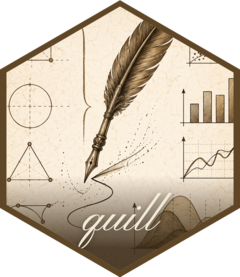

<!-- README.md is generated from README.Rmd. Please edit that file -->

```{r, include = FALSE}
knitr::opts_chunk$set(
  collapse = TRUE,
  comment = "#>",
  fig.path = "man/figures/README-",
  out.width = "100%"
)
```

# vellumplot 

<!-- badges: start -->
[](https://github.com/r-vellum/vellumplot/actions/workflows/R-CMD-check.yaml)
<!-- badges: end -->

```{r echo = FALSE, message = FALSE, warning = FALSE}
knitr::opts_chunk$set(
  collapse = TRUE,
  comment = "#>",
  fig.path = "man/figures/README-",
  dev = "ragg_png",
  dpi = 200,
  out.width = "100%"
)
```

vellumplot is a declarative, pipe-first grammar of graphics built on the
[vellum](https://github.com/r-vellum/vellum) graphics backend. You describe a
plot as an inspectable, serializable *spec*; nothing is drawn until the spec is
compiled into a vellum scene and rendered.

Compiling walks a fixed pipeline: resolve encodings, train scales, measure
layout, compile guides, compile marks, emit a vellum scene. It needs no graphics
device, because vellum measures text itself. If you already know ggplot2 the
grammar will feel familiar; the difference is that the compiled scene is kept
around afterwards, and a lot follows from that.

### What is different here

Most of the following exists somewhere in R already. Having it in one grammar,
from one spec, is the unusual part.

* `render_plot()` writes PNG, SVG, PDF, or PowerPoint from one compiled scene,
  so the layout is solved once instead of once per device. The PDF carries a
  structure tree and alt text, which lets a screen reader navigate it; tagged PDF
  output is rare for R graphics. A `.pptx` slide holds editable shapes and text
  boxes rather than a picture.
* Accessibility is something you can check. Render through a
  colour-vision-deficiency simulation
  (`render_plot(p, "p.png", cvd = "deuteranopia")`) to see the figure the way a
  colour-blind reader will, and run `plot_lint()` to catch tiny text, low
  contrast, or a single-level legend before you publish.
* A compiled plot is a vellum scene, so every element keeps its data key and its
  resolved device-pixel box (`vellum::scene_model()`).
  [vellumwidget](https://github.com/r-vellum/vellumwidget)'s `as_widget()` reads
  both for tooltips, brushing, and linked selection. Nothing re-draws the plot in
  the browser and there are no `*_interactive()` twins to keep in sync, so the
  static and interactive figures cannot drift apart.
* Effects and regions stay vector where they can. `glow()` / `shadow()` are real
  Gaussian blur and work on text; Venn/Euler diagrams and merged choropleth
  regions are computed as boolean geometry rather than alpha-composited overlaps,
  so they stay crisp in a PDF instead of being flattened to pixels.
* `pattern_*()` hatch fills encode a mapping as texture instead of hue, so it
  survives greyscale print and colour-vision deficiency. They render on every
  backend, PDF included.
* `transition_states()` plus `animate()` compile one keyframe per state, with
  scales frozen so the animation is non-reactive. Faceted plots animate too, and
  titles and text labels can count along with frame variables
  (`labs(title = "Year: {round(frame_time)}")`). `anim_save()` encodes a GIF, an
  APNG, or a resolution-independent animated SVG that honours
  `prefers-reduced-motion`, and `anim_frame()` saves one frame as a poster.
* `theme_sketch()` (or a `sketch =` argument) gives a plot a wobbly, hand-drawn
  look. The engine generates it, so it is exact and comes out the same in PNG,
  SVG, PDF, and PowerPoint, unlike a post-hoc filter.
* Math is typeset by the engine, with no LaTeX installation: `tex()`,
  `plotmath()`, and `$...$` inside `md()` work in titles, legend labels, text
  marks, annotations, and facet strips (`label_parsed()`).
* `theme_brand()` themes a plot from a brand.yml file (Quarto's `_brand.yml`):
  its colours, palette, and fonts.
* The spec is plain data. `summary()` shows a plot's structure without drawing it,
  and the spec round-trips, so you can inspect a plot, store it, and program
  against it.

## Installation

```r
# install.packages("pak")
pak::pak("r-vellum/vellumplot")
```

vellumplot needs the [vellum](https://github.com/r-vellum/vellum) backend, which
compiles a Rust crate, so you also need a Rust toolchain (`cargo`/`rustc`); pak
pulls vellum in automatically.

## Usage

Building a plot returns a spec; printing it draws into the Plots pane (and
embeds in a knitr/Quarto chunk), like ggplot2. Use `render_plot()` to write a
file.

```{r example}
library(vellumplot)

# a scatter with a continuous colour legend
vplot(mtcars) |>
  mark_point(x = wt, y = mpg, color = hp) |>
  scale_color_continuous()
```

Layer marks on a single panel; scales train across every layer:

```{r layers}
vplot(mtcars) |>
  mark_point(x = wt, y = mpg) |>
  mark_smooth(x = wt, y = mpg)
```

Facet into a grid of panels (`facet_wrap()` / `facet_grid()`), with shared or
free scales:

```{r facet}
vplot(mtcars) |>
  mark_point(x = wt, y = mpg) |>
  facet_wrap(~cyl)
```

Draw spatial data: `mark_sf()` renders an `sf` geometry column and `coord_sf()`
reprojects and locks the map aspect ratio:

```{r sf}
nc <- sf::st_read(system.file("shape/nc.shp", package = "sf"), quiet = TRUE)
vplot(nc) |>
  mark_sf(fill = BIR74) |>
  coord_sf()
```

Draw a network: `vgraph()` lays out an `igraph` graph (stress majorization by
default), then `mark_edges()` / `mark_nodes()` draw it, aspect-locked and without
axes, edges under nodes:

```{r network}
g <- igraph::make_graph("Zachary")
g <- igraph::set_vertex_attr(
  g,
  "grp",
  value = as.factor(igraph::cluster_louvain(g)$membership)
)
g <- igraph::set_vertex_attr(g, "deg", value = igraph::degree(g))
vgraph(g, layout = "stress") |>
  mark_edges(alpha = 0.4) |>
  mark_nodes(size = deg, fill = grp) |>
  scale_size(range = c(2, 8))
```

The spec is just data, so `summary()` shows its structure without drawing:

```{r summary}
summary(vplot(mtcars) |> mark_point(x = wt, y = mpg, color = hp))
```

Typeset math in any label with `tex()`, or between `$` signs in `md()`:

```{r math}
vplot(data.frame(x = seq(-3, 3, length.out = 200))) |>
  mark_line(x = x, y = dnorm(x)) |>
  annotate(
    "text", x = 2, y = 0.34, size = 14,
    label = tex("\\phi(x) = \\frac{1}{\\sqrt{2\\pi}}\\, e^{-x^2/2}")
  ) |>
  labs(title = "The standard normal density", y = md("density $\\phi(x)$"))
```

Write to a file with `render_plot()`; the format follows the extension (`.png`,
`.svg`, `.pdf`, or `.pptx` for a slide of editable shapes):

```{r save, eval = FALSE}
p <- vplot(mtcars) |> mark_point(x = wt, y = mpg)
render_plot(p, "cars.png")
render_plot(p, "cars.pptx")
```

## What's included

* Marks: `mark_point()`, `mark_line()`, `mark_step()`, `mark_rule()`,
  `mark_bar()` (explicit heights, or row counts per category), `mark_area()` /
  `mark_ribbon()`, intervals (`mark_errorbar()`, `mark_linerange()`,
  `mark_segment()`), `mark_boxplot()`, tiles/heatmaps (`mark_tile()`,
  `mark_raster()`), 2-D binning (`mark_bin2d()`, `mark_hex()`), 2-D density
  contours (`mark_contour()`, `mark_contour_filled()`), text (`mark_text()`,
  `mark_label()`), and pie/donut shortcuts (`mark_pie()`, `mark_donut()`).
* Spatial: `mark_sf()` draws an `sf` geometry column as a map layer, with
  `coord_sf()` to reproject and lock the aspect ratio.
* Network: `vgraph()` starts a node-link diagram from an `igraph` graph
  (stress layout by default, via `graphlayouts`), with `mark_edges()`,
  `mark_nodes()`, `mark_node_text()`, and `scale_edge_width()`.
* Encodings (tidy-eval): `x`, `y`, `color`/`fill`, `size`, `shape`, `alpha`.
  Point shapes take ggplot2's codes 0 to 25, drawn at R's sizes, as well as
  names.
* Position scales (`scale_x_continuous()`, `scale_y_continuous()`; linear and
  `log10`) with auto-trained, expanded domains; discrete band scales
  (`scale_x_discrete()`, `scale_y_discrete()`) for categorical axes.
* Colour scales (`scale_color_continuous()` / `scale_fill_continuous()`,
  `scale_color_discrete()` / `scale_fill_discrete()`, `_gradient()`, `_binned()`,
  `_manual()`), `scale_shape()`, and trained `scale_size()` /
  `scale_linewidth()`, with stacked legends.
* Trained axes, a panel with gridlines, and layering on one panel;
  `guide_axis()` (`angle`, `n.dodge`, `check.overlap`, `cap`, minor ticks) and
  `guide_axis_logticks()`.
* Faceting (`facet_wrap()`, `facet_grid()`) with shared or free scales, via the
  `resolve_scale()` lattice. ggplot2's labellers (`label_value()`,
  `label_both()`, `label_wrap_gen()`, `label_parsed()`, `as_labeller()`), and
  strip text clipped to its strip unless `theme(strip.clip = "off")`.
* Statistical marks: `mark_histogram()`, `mark_density()`, `mark_summary()`,
  `mark_smooth()` (with `after_stat()`).
* Coordinate systems: `coord_cartesian()`, `coord_flip()`, `coord_fixed()` /
  `coord_equal()`, `coord_trans()` (nonlinear display remap),
  `coord_polar()` (pie / coxcomb / radar), and `coord_sf()`.
* Position adjustments: stack / dodge / fill bars, jittered points.
* Per-mark `blend =` modes (CSS `mix-blend-mode`: `"multiply"`, `"screen"`, ...).
* `mark_datashade()` for million-point density rasters.
* Annotations: `annotate()`, `labs()`, `md()` markdown titles, and math
  labels (`tex()`, `plotmath()`, `$...$` in `md()`, `parse = TRUE` on text
  marks).
* Themes (`theme_gray()` default, `theme_minimal()`, `theme_bw()`,
  `theme_classic()`, `theme_light()`, `theme_dark()`, `theme_linedraw()`,
  `theme_void()`, `theme_cyberpunk()`, `theme_brand()` from a brand.yml file,
  `theme()` / `set_theme()`) and multi-plot composition (`hconcat()`,
  `vconcat()`, `concat()`, `wrap_plots()`, `inset()`, `repeat_()`), with
  figure titles and A/B/C tags from `compose_annotation()`.
* Layer effects (`glow()`, `outline()`, `shadow()`, `motion()`, `echo()`) and
  gradient fills (`linear_gradient()`, `radial_gradient()`).
* Pattern (hatch) fills: `pattern_stripe()`, `pattern_crosshatch()`,
  `pattern_grid()`, `pattern_dot()`, `pattern_checker()`, mapped via
  `scale_pattern()`, greyscale- and colour-vision-safe, on every backend.
* Boolean marks: `vvenn()` draws 2-/3-set Venn/Euler diagrams as solid geometry,
  and `mark_sf(merge = TRUE)` dissolves adjacent same-value regions into one.
* SVG icon markers (`shape = ` a `d` path string or a `.svg` file) and repelled
  labels (`mark_text_repel()`, over the engine's overlap solver).
* Accessibility: tagged PDF output, `plot_lint()` for legibility/contrast
  problems, colour-vision-deficiency simulation at render time, and font pinning
  for reproducible text.
* Animation: `transition_states()` / `transition_time()` / `transition_reveal()`,
  `ease_aes()` (per aesthetic), `animate()` (with facets, pauses and rewind),
  frame variables in titles and `mark_text()` labels, `anim_save()` to GIF /
  APNG / animated SVG, and `anim_frame()` for a still of any frame.
* Output: `render_plot()` (PNG/SVG/PDF/PowerPoint), `pdf_pages()` (multi-page
  reports or one page per facet), `vellum::pptx_pages()` and `vellum::as_dml()`
  for slide decks (with or without officer), `render_all()` (parallel batch),
  and `plot_svg()` for an inline SVG string (e.g. a sparkline inside a `gt`
  table).
* Hand-drawn rendering: `sketch()` gives any geometry mark a wobbly, hachure-
  filled [Rough.js](https://roughjs.com) look (a `sketch =` argument on marks, an
  `element_line()` / `element_rect()` `sketch =` slot, or the plot-wide
  `theme_sketch()` one-liner). Generated natively in the engine, so it is exact
  and works across PNG / SVG / PDF / PowerPoint.

## The vellum ecosystem

vellumplot is the grammar layer of a small ecosystem of packages that share the
vellum scene model:

- **[vellum](https://github.com/r-vellum/vellum)**, the parchment: the low-level
  graphics backend (Rust scene graph, PNG/SVG/PDF/PowerPoint renderer).
- **[vellumplot](https://github.com/r-vellum/vellumplot)**, the pen: this package.
- **[vellumwidget](https://github.com/r-vellum/vellumwidget)**, the annotation:
  turns a vellumplot plot (or a raw vellum scene) into a client-side interactive
  HTML widget via `as_widget()`.
- **[vellumverse](https://github.com/r-vellum/vellumverse)** installs and loads
  the whole ecosystem in one step.
